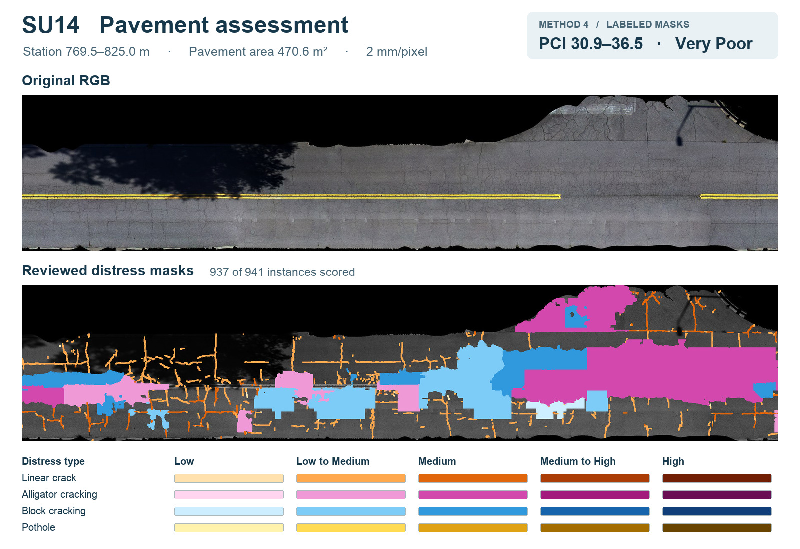
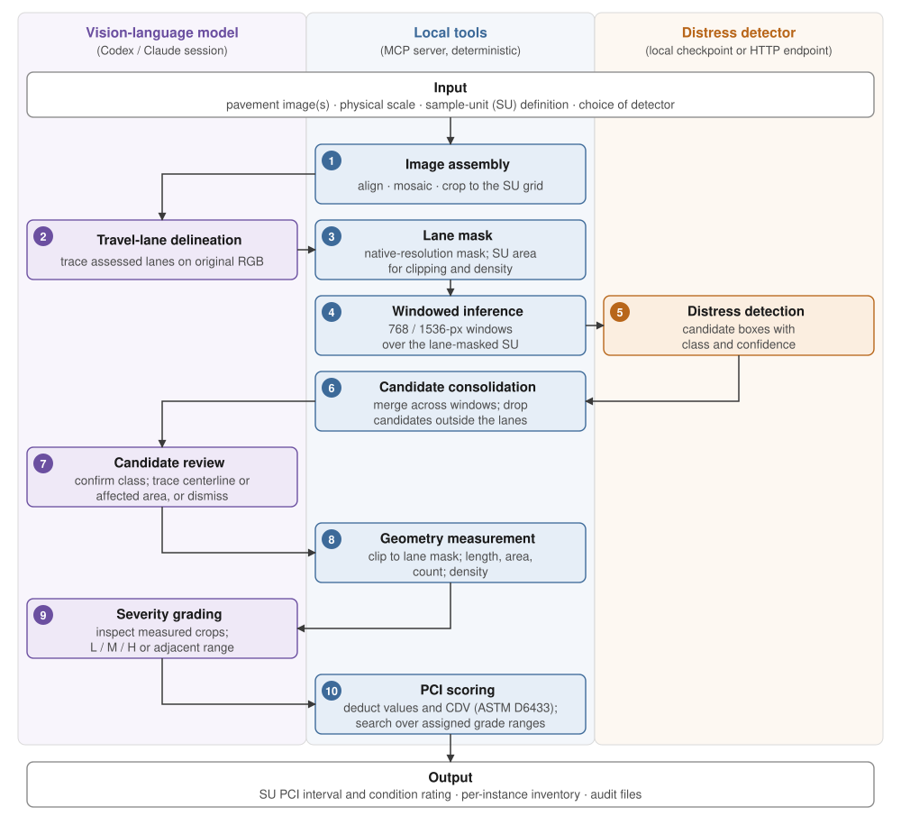

# PCI Agent

PCI Agent assesses one asphalt pavement Sample Unit (SU) per run. It assembles the source imagery, identifies the travel lanes in RGB, masks surrounding areas, runs a detector selected by the user, sends marked and original RGB crops to the vision model in Codex or Claude for individual grading, and computes density and a PCI interval with the bundled road deduct curves. Public edition maintained by [alex-yimingyang](https://github.com/alex-yimingyang).

## Worked example from the four-method report



**SU14 · PCI 30.9–36.5 · Very Poor.** Both panels show the full 470.6 m² sample unit at the same scale. Orange marks linear cracks, pink marks alligator cracking and blue marks block cracking. Within each class, darker shades indicate higher severity.

This example reproduces **Method 4 (Labeled masks)** on page 14 of the *SU01–20 Four-Method PCI Comparison, Reviewed Boundaries* report. It uses the report’s class labels and boundaries, with per-instance severity grading and false-positive review. Of 941 candidates, 937 contributed to the score, including 201.6 m of linear cracking, 63.8 m² of block cracking and 101.2 m² of alligator cracking. The interval shown is the archived report result. The current agent starts a new assessment from original images and a user-selected detector.

## Installation and launch

Install Python 3.12 and run these commands from the project directory.

```sh
python3.12 -m venv .venv
.venv/bin/python -m pip install -r requirements.txt -r requirements-images.txt
```

- **Codex CLI** — sign in to Codex, then run `sh ./launch-chat.sh` in this directory.
- **Claude Code** — run `claude mcp add --scope local --transport stdio road_pci -- /bin/sh "$PWD/launch-mcp.sh"`, then open `claude` in this directory.
- **Desktop MCP clients** — configure a stdio server named `road_pci`, command `/bin/sh`, and the absolute path to `launch-mcp.sh` as its sole argument. Allow 620 seconds per tool call for larger units.

Provide the detector address for each new assessment. For a **local model**, give an existing Ultralytics `.pt` checkpoint and install a compatible Ultralytics version in the detector environment. Set `PCI_DETECTOR_PYTHON` to that environment’s Python if it differs from the image environment. For a **server model**, give its HTTP(S) inference endpoint. The client sends each PNG tile to the selected endpoint and asks the current vision session to grade the resulting crops. The public package includes the report figure above. Assessment inputs and run records are stored separately.

On a detector host, start the supplied adapter with `python serve_detector.py --weights /models/pavement.pt --port 8765`. Its default bind address is loopback. From the workstation, `ssh -L 8765:127.0.0.1:8765 user@gpu-host` makes the endpoint available at `http://127.0.0.1:8765/predict`. An existing compatible server accepts POST with a raw PNG body, `Content-Type: image/png`, and an `X-Confidence` threshold. It returns `{"detections":[{"class_id":0,"label":"linear_crack","confidence":0.9,"box":[2,3,80,110]}]}` in tile-local pixel coordinates.

## What to provide

| Input | What to give the agent |
|---|---|
| Original pavement images | Give a file path the computer running the MCP server can read, one per image. Use one photo covering the SU or adjoining orthophotos of the same SU. |
| Distress detector | Give the path to a local Ultralytics detection or instance-segmentation `.pt` checkpoint, or the full HTTP(S) inference endpoint. Choose the detector for each assessment. Codex or Claude supplies the vision session for lane delineation and severity review. |
| Physical scale for Quantity | Give meters per pixel (e.g., **0.002 m/px**), the actual width or height of the first full source image, or the known area of the valid pavement. An aligned CAE station-to-UTM mapping is also supported. If unknown, say **“use pixels.”** |
| Sample Unit for Density | Identify the road section and lanes to assess. If one image covers the unit, say **“use this image as the SU.”** For several images, confirm they form one unit. Supply a boundary, dimensions and location, or a known area if the unit is smaller than the imagery. A reference area alone may require a follow-up to locate the boundary. |
| Placement or boundary, when needed | With unreferenced images that lack reliable overlap, give the top-left pixel offset of every image. An optional SU boundary may be a rectangle, a polygon, or a single-channel mask aligned to the **uncropped mosaic** (0 outside, nonzero inside). The agent generates the travel-lane mask after cropping. |

### Image formats

| Verified input | Pixel layout | Usage |
|---|---|---|
| JPEG (`.jpg`, `.jpeg`) | 8-bit grayscale or RGB | A single original or a set of aligned photos. JPEG compression can obscure fine cracks. |
| PNG (`.png`) | 8-bit grayscale, RGB or RGBA | Original frames and lossless tiles. Transparent pixels are excluded from coverage. |
| TIFF / GeoTIFF (`.tif`, `.tiff`) | 8-bit grayscale, RGB or RGBA | Large orthophotos and mosaics. GeoTIFFs on the same coordinate system and pixel grid can be placed automatically. |

For 16-bit, floating-point, indexed-color or multispectral imagery, export a grayscale or true-color 8-bit copy and preserve the pixel grid and georeferencing. For video, supply extracted still frames. Reliable physical measurement requires a consistent ground scale across the assessed pavement; orthorectify oblique views before measuring.

**Single-image example** — “Assess `/data/SU01.tif` with the detector at `/models/pavement.pt`. Use this image as one SU. I have no physical scale, so use pixels. Exclude shoulders and grass and return the per-instance measurements and PCI proxy interval.”

## Agent architecture



## Define one Sample Unit

Start with the original orthophoto or adjoining orthophotos at a common native scale. The agent asks for the detector, the physical scale for Quantity, and the boundary or area of the SU for Density.

| Input condition | Agent behavior |
|---|---|
| One photo, no separate SU | Uses that image’s valid pavement pixels as one SU. |
| One photo covers only part of a specified SU | Requests neighboring photos if the supplied imagery falls short of the target extent or area. |
| Multiple photos cover one SU | Places images by supplied integer offsets, compatible GeoTIFF grids, or reliable visual matches in overlapping orthophotos. It takes each location’s first valid original pixel in input order. Overlaps count once. |
| A source image or mosaic extends beyond the SU | Crops to the supplied rectangle, polygon or pavement ROI. With rectangular SU dimensions it crops at the requested origin, defaulting to the mosaic’s upper-left corner. If only a smaller area is known, the agent asks for its location or boundary. |
| The complete SU exceeds the detector’s input size | Uses overlapping native 768- and 1536-pixel windows, converts predictions to the cropped SU grid, and merges overlapping same-class boxes. One set of reviewed instances is measured against one SU area. |

For inputs without georeferencing, automatic alignment requires a common orientation, square pixel scale, and distinctive overlapping pavement texture. Photos with different viewpoints or scales should first be orthorectified. For non-overlapping adjacent tiles, provide their known placement. Missing pixels inside a requested boundary trigger a request for additional imagery. An optional user-supplied boundary limits the area considered for automatic road segmentation.

### Example request

> Assess these two road images as one SU. The second image starts 600 pixels to the right of the first. Use the SU rectangle from (120, 30) to (1320, 730), a scale of 2 mm per pixel, and the detector at [my path or endpoint]. Review each numbered candidate, grade its severity, and report the SU PCI interval.

The `prepare_sample_unit` tool accepts the following inputs:

```json
{
  "images": [
    {"path":"/data/frame-a.png","offset_xy":[0,0]},
    {"path":"/data/frame-b.png","offset_xy":[600,0]}
  ],
  "model_address":"/models/pavement.pt",
  "physical_scale":{"status":"known","m_per_px":0.002},
  "sample_unit":{"mode":"roi"},
  "bounds_xyxy":[120,30,1320,730]
}
```

Pixel rectangles use inclusive left/top and exclusive right/bottom edges. With georeferencing or visual alignment, the first image is at (0,0); explicit offsets define their own common origin. A polygon uses this same grid. A binary ROI raster covers the uncropped mosaic extent. Numbered detector boxes and subsequent instance geometry use the **cropped SU’s** upper-left corner as (0,0). The saved assembly manifest records the translation to the source grid.

For a rectangular SU use `{"mode":"roi","size_px":[1200,700],"origin_xy":[120,30]}`, or `size_m` with a uniform physical scale. Use `{"mode":"mosaic"}` to confirm that the full rectangular multi-image mosaic is one unit. Use `{"mode":"provided","area_px2":840000}` or `area_m2` to check the imagery against a known area. With a separate physical area and no pixel scale, provide its boundary as well. For a single original covering the whole SU, use `{"mode":"single_image"}`.

## Automatic travel-lane segmentation

After alignment and cropping, `prepare_sample_unit` returns the original RGB overview. The current vision model in Codex or Claude identifies the lanes to assess, using edge lines, curbs, changes in surface and continuity along the road. For long units or ambiguous edges it can inspect original RGB windows with `read_carriageway_detail`. It calls `segment_carriageway_and_detect` with the lane outline in cropped SU coordinates. This step needs no separate segmentation model, endpoint or manually drawn mask.

Paved and unpaved shoulders, grass, soil, sidewalks and median islands are excluded. Markings, patches, shadows and visible distress within the assessed lanes stay in the mask. Fully paved inputs can retain the entire valid area. If the model cannot determine the carriageway boundary even after inspecting detailed views, the workflow requests a verified boundary. Background-only units stop before detection or scoring.

The same native-resolution mask limits detector windows, clips distress measurements and defines the area used for density. The run saves the mask (`carriageway.tif`), an overlay with excluded areas in red (`carriageway-overlay.jpg`), and the segmentation outline, visual evidence and pixel counts (`carriageway.json`). To revise an outline, reuse the original preparation run ID. Each revision creates a separate assessment.

## Measurement and scoring

Without physical calibration, answer `{"status":"unavailable"}`. Lengths are measured in pixels and areas in square pixels. With calibration they are reported in meters and square meters, and potholes are counted individually. Full-image width or height in meters refers to the first source before cropping. A supplied calibration area refers to the valid pavement on the assembled SU. Density uses the retained travel-lane area within the selected SU, in compatible units. In the absence of physical calibration, a reference-area PCI proxy is reported separately when computable.

The client reviews detector labels and paired RGB crops, traces centerlines or affected boundaries, or records a reason to dismiss a candidate. It then inspects the measured geometry and assigns severity per instance. The PCI interval varies grades within these assessed ranges. Detector confidence, box area, and window-level scores do not substitute for this assessment.

Each run persists local audit files including `assembly.json`, the cropped SU raster, detector evidence, instance measurements and the PCI result. Set `PCI_AGENT_RUNS` to select their parent directory. `PCI_IMAGE_PYTHON` selects the Python with the image dependencies.

## What the models return and where to find it

| Producer | Output for one SU | Files to inspect |
|---|---|---|
| Session vision model, lane assessment | An assessed-lane outline and the visual evidence for its boundary. Local tools rasterize it and count the retained and excluded pixels. | `carriageway.json`, `carriageway.tif`, `carriageway-overlay.jpg` (red means excluded) |
| User-selected distress detector | Candidate boxes with a class ID, label and confidence for each detection. The agent merges repeated detections across windows, assigns instance IDs and logs candidates fully outside the lane. | `detector.json`, `detector_overview.jpg` |
| Session vision model, instance review | A reviewed class and traced centerline or affected-area boundary, or a reason for dismissal. After viewing the measured crop, the model assigns L, M, H or a justified adjacent range (L–M or M–H) to each retained instance and records the visual evidence. | `detections.json`, `instance_judgments_and_measurements.json` |
| Local measurement tools | Linear cracks by length (m or px), alligator cracking, block cracking and patches by affected area (m² or px²), potholes by count. Each row gives quantity, density and units. Area density is a percentage; length and count densities are reported per 100 units of retained lane area. | `detected_measurements.json` |
| Local PCI engine | The SU lower and upper PCI and the corresponding condition label(s) in the tool response. `pci_interval` uses physical calibration. Without a scale, `pci_proxy_interval` uses an assumed **5,000 ft²** reference area. An unresolved crack subtype yields a preferred-class estimate. | `detected_pci.json`, `pci_bounds_details.json`, `result/deduct_values.csv`, `result/cdv_iterations.csv` |

The interval varies the allowed severity of each instance while holding its reviewed class and geometry fixed. Unresolved grading or geometry conflicts can return a review status before a score is available. A scene containing only background stops at lane assessment.

Files are stored under `runs/<run_id>/` by default. Preparation, measurement and scoring have separate run IDs. Open the final tool response’s `result_json` first. The result records `prepared_run_id` and `measurement_run_id`; its `carriageway.source_run_id` points to the original SU assembly.

## Verification

```sh
.venv/bin/python -B tests/verify_sample_imagery.py
.venv/bin/python -B tests/verify_detector_handoff.py
```

The first test checks registration, pixel-exact cropping, missing coverage, overlap accounting and native-window coverage. The second checks masking, excluded candidates, clipped crack lengths and net density area, then exercises the PCI engine with fixture detector predictions.
